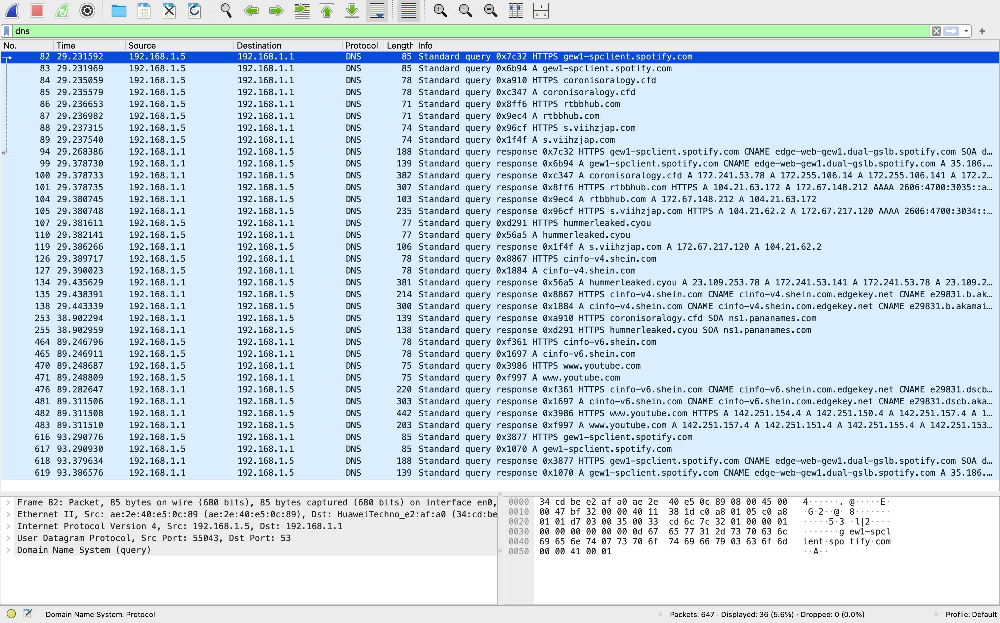
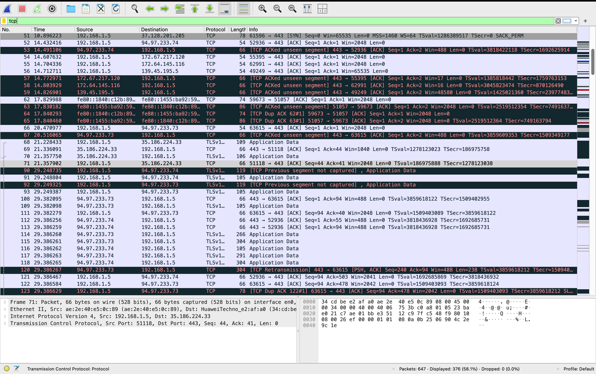
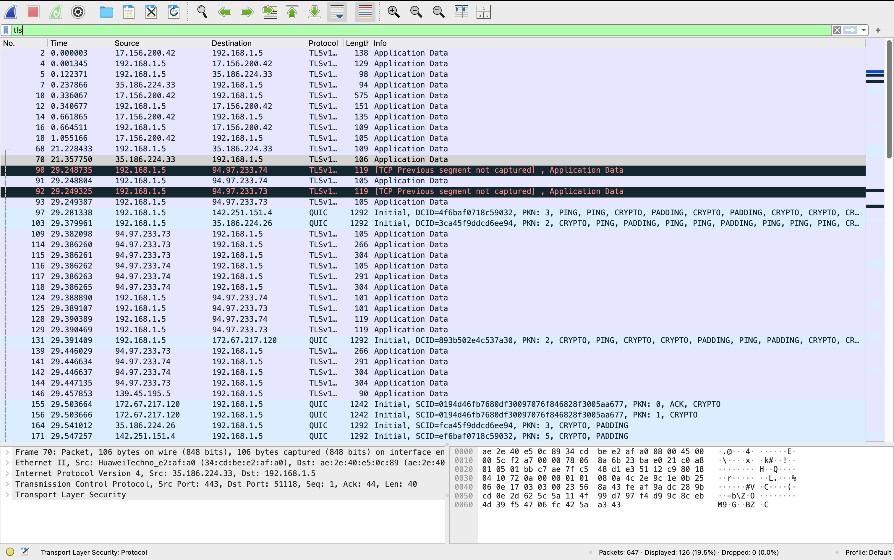

# Network Traffic Analysis Using Wireshark

## Overview
This project focused on capturing and analyzing real network traffic using Wireshark. Network packets were collected during normal web browsing activities and analyzed to understand communication patterns, protocol usage, DNS requests, and encrypted network connections.

## Objectives
- Understand how network traffic is transmitted across a network.
- Analyze common network protocols such as DNS, TCP, and TLS.
- Identify IP addresses involved in network communications.
- Investigate DNS queries and encrypted connections.

## Tools and Technologies
- Wireshark 4.6.9
- macOS
- TCP/IP
- DNS
- TLS/HTTPS

## Methodology
1. Selected the Wi-Fi network interface (en0).
2. Captured live network traffic.
3. Applied DNS, TCP, and TLS filters.
4. Analyzed packets and communication patterns.
5. Documented findings and recommendations.

## Results
### Protocols Observed
- DNS
- TCP
- TLS
- QUIC

### DNS Findings
- spclient.wg.spotify.com
- cinfo-v4.shein.com
- cinfo-v6.shein.com
- configuration.ls.apple.com

### IP Addresses Identified
- 192.168.1.5
- 192.168.1.1
- 94.97.233.74
- 35.186.224.33
- 172.67.217.120

### Traffic Analysis
- Observed encrypted HTTPS traffic through TLS.
- Identified DNS requests and TCP sessions.
- No suspicious activity was detected.

## Security Recommendations
- Use HTTPS whenever possible.
- Monitor unusual network traffic.
- Keep systems updated.
- Perform periodic traffic analysis.

## Limitations
- Short capture duration.
- Limited to local device traffic.
- Encrypted TLS payloads could not be fully inspected.
## Screenshots

### DNS Analysis

### TCP Analysis

### TLS Analysis

